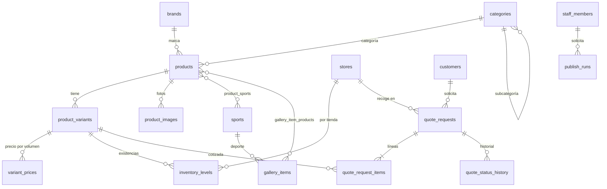
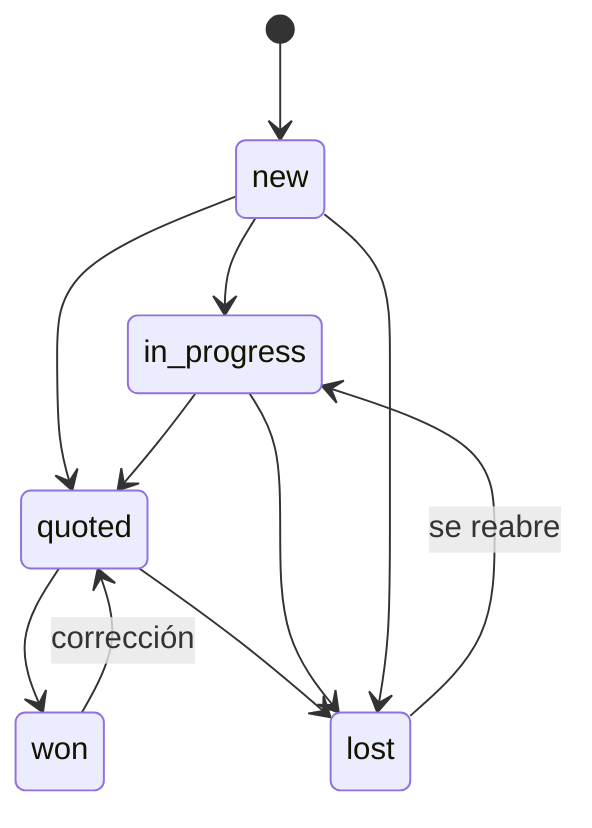

# 05 · Esquema del backend

> **Documento para construir.** Define la base de datos (Supabase / Postgres), su seguridad, las funciones y los contratos de las Edge Functions. Claude Code escribe las migraciones a partir de aquí.
>
> | Campo | Valor |
> |---|---|
> | Versión | 0.1 |
> | Fecha | 1-oct-2026 |
> | Documentos relacionados | `02-TRD.md` (arquitectura) · `04-APP-FLOW.md` (cuándo se llama cada cosa) · `data/sitio-actual.md` (taxonomía y formato del CSV) |

---

## 1. Principios

1. **Esquema de comercio completo desde v1.** Producto → variante (SKU) → precios por volumen → existencias por tienda. En modo catálogo los precios y existencias existen pero no salen al sitio.
2. **Todo producto tiene al menos una variante.** Un producto "sin variantes" tiene una sola variante por defecto (`is_default = true`, mismo SKU que el producto). Así la lista de cotización, los precios y el inventario siempre apuntan a una variante.
3. **El sitio público nunca lee tablas, solo vistas `public_*`.** Las vistas filtran lo publicado y omiten columnas comerciales y privadas.
4. **RLS activado en todas las tablas.** `anon` no tiene políticas sobre tablas base. El personal entra con políticas basadas en `staff_members`.
5. **Las escrituras públicas pasan por Edge Functions** (con `service_role`), nunca por inserciones directas del navegador.
6. **Las fotos no viven en la base de datos:** se guarda la clave base del archivo en R2 y sus medidas.
7. **Nada se cambia a mano en el dashboard.** Todo cambio es una migración SQL versionada en `supabase/migrations/`.
8. Nombres de tablas y columnas en inglés, `snake_case`. Dinero en **centavos** (`integer`) y moneda `MXN`. Fechas en `timestamptz`; el "día" de negocio se calcula en `America/Mexico_City`.

## 2. Diagrama



Tablas sin relaciones: `site_media`, `site_texts`, `settings`, `folio_counters`, `system_heartbeats`.

## 3. Extensiones y tipos

```sql
create extension if not exists unaccent;
create extension if not exists pg_trgm;

create type staff_role        as enum ('admin', 'editor');
create type product_status    as enum ('draft', 'published', 'archived');
create type audience          as enum ('adulto', 'infantil', 'unisex');
create type customer_type     as enum ('league_team', 'school_academy', 'company_institution', 'individual');
create type delivery_method   as enum ('pickup', 'shipping');
create type quote_status      as enum ('new', 'in_progress', 'quoted', 'won', 'lost');
create type content_status    as enum ('draft', 'published');
create type publish_status    as enum ('queued', 'running', 'success', 'failed');
```

Etiquetas en español para la interfaz (en `packages/shared`):

| Tipo | Valores → etiqueta |
|---|---|
| `customer_type` | `league_team` Liga o equipo · `school_academy` Escuela o academia · `company_institution` Empresa o institución · `individual` Particular |
| `delivery_method` | `pickup` Recoger en tienda Coapa · `shipping` Envío (lo acordamos por WhatsApp) |
| `quote_status` | `new` Nueva · `in_progress` En atención · `quoted` Cotizada · `won` Ganada · `lost` Perdida |
| `product_status` | `draft` Borrador · `published` Publicado · `archived` Archivado |
| Técnicas (`text[]`) | `sublimacion` · `vinil` · `bordado` · `serigrafia` |

## 4. Tablas

Todas llevan `created_at timestamptz not null default now()`; las editables llevan además `updated_at` mantenido por el trigger `set_updated_at`. Se omiten en los listados para abreviar.

### 4.1 Personal

```sql
create table staff_members (
  user_id    uuid primary key references auth.users(id) on delete cascade,
  role       staff_role not null default 'editor',
  full_name  text not null,
  is_active  boolean not null default true
);
```

### 4.2 Taxonomía

```sql
create table sports (
  id          uuid primary key default gen_random_uuid(),
  slug        text not null unique check (slug ~ '^[a-z0-9-]+$'),
  name        text not null,
  sort_order  int  not null default 0,
  is_active   boolean not null default true
);

create table categories (
  id            uuid primary key default gen_random_uuid(),
  parent_id     uuid references categories(id) on delete restrict,   -- null = categoría; con valor = subcategoría
  slug          text not null unique check (slug ~ '^[a-z0-9-]+$'),
  name          text not null,
  size_label    text not null default 'Talla',                       -- 'Talla' | 'Tamaño' | 'Peso': nombre de la opción 1 por defecto
  sort_order    int  not null default 0,
  is_active     boolean not null default true
);
-- Un solo nivel de subcategorías: trigger que impide que parent_id apunte a una subcategoría.

create table brands (
  id            uuid primary key default gen_random_uuid(),
  slug          text not null unique check (slug ~ '^[a-z0-9-]+$'),
  name          text not null,
  logo_key      text,                    -- clave base en R2, opcional
  is_own_brand  boolean not null default false,
  sort_order    int not null default 0
);
```

`size_label` inicial: `balones` → Tamaño · `box-y-combate` → Peso · `material-entrenamiento` → Tamaño · resto → Talla.

### 4.3 Catálogo

```sql
create table products (
  id                 uuid primary key default gen_random_uuid(),
  sku                text not null unique,
  slug               text not null unique check (slug ~ '^[a-z0-9-]+$'),
  name               text not null,
  brand_id           uuid not null references brands(id),
  category_id        uuid not null references categories(id),
  subcategory_id     uuid references categories(id),
  audience           audience not null default 'unisex',
  short_description  text not null default '',
  description        text not null default '',
  specs              jsonb not null default '[]',      -- [{ "label": "Tela", "value": "…" }]
  tags               text[] not null default '{}',
  option1_name       text not null default 'Talla',    -- se inicializa con categories.size_label
  option2_name       text,                             -- 'Color' o null
  color_note         text,                             -- p. ej. 'A elegir' cuando el color no es variante
  is_customizable    boolean not null default false,
  techniques         text[] not null default '{}'
                     check (techniques <@ array['sublimacion','vinil','bordado','serigrafia']),
  min_suggested_qty  int check (min_suggested_qty > 0),
  is_featured        boolean not null default false,
  sort_order         int not null default 0,
  status             product_status not null default 'draft',
  published_at       timestamptz,                      -- se fija la primera vez que pasa a 'published'
  legacy_url         text,                             -- URL del sitio WordPress, para redirecciones
  search_text        text not null default '',         -- minúsculas sin acentos; lo mantiene un trigger
  created_by         uuid references auth.users(id)
);
create index on products (status, is_featured desc, sort_order);
create index on products (category_id);
create index on products using gin (search_text gin_trgm_ops);

create table product_sports (
  product_id uuid not null references products(id) on delete cascade,
  sport_id   uuid not null references sports(id) on delete restrict,
  primary key (product_id, sport_id)
);

create table product_variants (
  id             uuid primary key default gen_random_uuid(),
  product_id     uuid not null references products(id) on delete cascade,
  sku            text not null unique,
  option1_value  text,              -- 'CH', '#5', '16oz'… null en la variante por defecto
  option2_value  text,              -- 'Rojo'… o null
  is_default     boolean not null default false,
  is_active      boolean not null default true,
  sort_order     int not null default 0,
  unique nulls not distinct (product_id, option1_value, option2_value)   -- Postgres 15+
);
create unique index one_default_variant on product_variants (product_id) where is_default;

create table product_images (
  id          uuid primary key default gen_random_uuid(),
  product_id  uuid not null references products(id) on delete cascade,
  variant_id  uuid references product_variants(id) on delete set null,
  key_base    text not null unique,     -- 'p/{productId}/{imageId}'  → archivos '{key_base}-{320|640|1024|1600}.webp'
  alt         text not null default '',
  width       int not null,             -- del original recortado (4:5)
  height      int not null,
  sort_order  int not null default 0
);
```

**Reglas del catálogo**
- Un producto solo puede publicarse si tiene nombre, marca, categoría y al menos una variante activa (trigger `validate_product_publish`).
- "Tiene variantes" en la interfaz = más de una variante activa. Con una sola, la tarjeta muestra "+ Cotizar".
- SKU de variante: `{sku}-{OPCION1}-{OPCION2}` en mayúsculas, sin acentos y con guiones (`BAL-005-5-BLANCO-ROJO`). La variante por defecto usa el SKU del producto.
- El importador genera variantes como producto cartesiano de tallas × colores. Si `tallas = unitalla` y no hay colores, crea solo la variante por defecto. Si `colores = "A elegir"`, no crea dimensión de color y guarda `color_note`.

### 4.4 Comercio oculto (modo catálogo) y tienda

```sql
create table variant_prices (
  variant_id        uuid not null references product_variants(id) on delete cascade,
  min_qty           int  not null default 1 check (min_qty >= 1),   -- escala por volumen
  unit_price_cents  int  not null check (unit_price_cents >= 0),
  currency          char(3) not null default 'MXN',
  primary key (variant_id, min_qty)
);

create table stores (
  id            uuid primary key default gen_random_uuid(),
  slug          text not null unique,
  name          text not null,
  street        text not null,
  neighborhood  text not null,
  borough       text not null,
  postal_code   text not null,
  city          text not null default 'Ciudad de México',
  lat           numeric(9,6),
  lng           numeric(9,6),
  phone         text,
  email         text,
  hours         jsonb not null default '[]',   -- [{ "days": [1,2,3,4,5], "open": "10:00", "close": "19:00" }] (1 = lunes)
  directions    text not null default '',      -- referencias para llegar y estacionamiento
  is_active     boolean not null default true,
  sort_order    int not null default 0
);

create table inventory_levels (
  variant_id  uuid not null references product_variants(id) on delete cascade,
  store_id    uuid not null references stores(id) on delete cascade,
  quantity    int  not null default 0,
  primary key (variant_id, store_id)
);
```

### 4.5 Clientes y solicitudes de cotización

```sql
create table customers (
  id             uuid primary key default gen_random_uuid(),
  phone          text not null unique check (phone ~ '^[0-9]{10}$'),   -- 10 dígitos, sin +52
  name           text not null,
  customer_type  customer_type not null,
  organization   text,
  quote_count    int not null default 0,
  first_seen_at  timestamptz not null default now(),
  last_seen_at   timestamptz not null default now()
);

create table folio_counters (
  year        int primary key,
  last_value  int not null default 0
);

create table quote_requests (
  id                   uuid primary key default gen_random_uuid(),
  folio                text not null unique,                 -- 'PYP-2026-000123'
  client_request_id    uuid not null unique,                 -- idempotencia
  customer_id          uuid not null references customers(id),
  status               quote_status not null default 'new',
  -- copia de los datos tal como se enviaron
  customer_name        text not null,
  customer_phone       text not null,
  customer_type        customer_type not null,
  organization         text,
  needed_by            date not null,
  delivery_method      delivery_method not null,
  store_id             uuid references stores(id),
  requires_invoice     boolean not null default false,
  note                 text not null default '',
  total_pieces         int not null check (total_pieces > 0),
  -- seguimiento interno
  lost_reason          text,
  internal_note        text not null default '',
  -- privacidad y abuso
  privacy_accepted_at  timestamptz not null,
  privacy_version      text not null,
  ip_hash              text,
  user_agent           text
);
create index on quote_requests (status, created_at desc);
create index on quote_requests (ip_hash, created_at);

create table quote_request_items (
  id                 uuid primary key default gen_random_uuid(),
  quote_request_id   uuid not null references quote_requests(id) on delete cascade,
  line_no            int not null,
  product_id         uuid references products(id) on delete set null,
  variant_id         uuid references product_variants(id) on delete set null,
  product_name       text not null,       -- copia: el producto puede cambiar o borrarse después
  sku                text not null,
  variant_label      text,                -- 'M', '#5 · Blanco/Rojo'
  quantity           int not null check (quantity between 1 and 9999),
  personalize        boolean not null default false,
  notes              text not null default '' check (char_length(notes) <= 500),
  unit_price_cents   int,                 -- vacío en modo catálogo
  unique (quote_request_id, line_no)
);

create table quote_status_history (
  id                bigint generated always as identity primary key,
  quote_request_id  uuid not null references quote_requests(id) on delete cascade,
  from_status       quote_status,
  to_status         quote_status not null,
  changed_by        uuid references auth.users(id),
  note              text not null default ''
);
```

**Folio:** `PYP-{año}-{consecutivo de 6 dígitos}`. El año es el de `America/Mexico_City`. El consecutivo reinicia cada año y se toma de `folio_counters` con bloqueo de fila (`insert … on conflict do update … returning`), dentro de la misma transacción que crea la solicitud.

**Transiciones de estado** (las valida `admin_set_quote_status`):



`lost` exige `lost_reason`.

### 4.6 Galería

```sql
create table gallery_items (
  id                    uuid primary key default gen_random_uuid(),
  team_name             text not null,
  sport_id              uuid references sports(id),
  year                  int,
  key_base              text not null unique,    -- 'g/{galleryId}/{imageId}'
  alt                   text not null default '',
  width                 int not null,
  height                int not null,
  includes_minors       boolean not null default false,
  has_written_consent   boolean not null default false,
  has_guardian_consent  boolean not null default false,
  status                content_status not null default 'draft',
  sort_order            int not null default 0,
  constraint consent_to_publish check (
    status = 'draft'
    or (has_written_consent and (not includes_minors or has_guardian_consent))
  )
);

create table gallery_item_products (
  gallery_item_id uuid not null references gallery_items(id) on delete cascade,
  product_id      uuid not null references products(id) on delete cascade,
  primary key (gallery_item_id, product_id)
);
```

### 4.7 Fotos y textos del sitio, ajustes

```sql
create table site_media (
  slot        text primary key check (slot in (
                'home_hero', 'uniforms_hero',
                'technique_sublimacion', 'technique_vinil', 'technique_bordado',
                'store_front', 'store_workshop', 'advisor')),
  key_base    text,                 -- 's/{slot}/{imageId}'; null = sin foto (el sitio muestra el marcador)
  alt         text not null default '',
  width       int,
  height      int,
  updated_by  uuid references auth.users(id)
);

create table site_texts (
  key         text primary key,
  value       jsonb not null,
  updated_by  uuid references auth.users(id)
);

create table settings (
  key        text primary key,
  value      jsonb not null,
  is_public  boolean not null default false
);
```

Claves de `site_texts`:

| Clave | Forma de `value` |
|---|---|
| `advisor` | `{ "name": "[Ana Martínez]", "role": "Asesora de uniformes", "quote": "…" }` |
| `uniforms_faq` | `[{ "question": "¿Cuál es el pedido mínimo?", "answer": "[PEDIDO MÍNIMO]" }, …]` |
| `store_history` | `{ "text": "[HISTORIA DE LA TIENDA]" }` |
| `privacy_notice` | `{ "version": "2026-10", "updatedAt": "[FECHA]", "sections": [{ "title": "Quién es responsable", "body": "…" }, …] }` |

Claves de `settings`:

| Clave | Valor inicial | Pública |
|---|---|---|
| `whatsapp_sales_number` | `"5500000000"` ⚠️ placeholder | Sí |
| `site_name` | `"P&P Deportes Coapa"` | Sí |
| `social` | `{ "instagram": "pyp_coapa", "facebook": "pypcoapa" }` | Sí |
| `flags` | `{ "show_prices": false, "enable_checkout": false, "enable_shipping": false, "enable_stock": false }` | Sí |
| `ga_measurement_id` | `null` | Sí |
| `quote_rate_limit` | `{ "per_ip_hour": 5, "per_phone_hour": 5 }` | No |

### 4.8 Operación

```sql
create table publish_runs (
  id            uuid primary key default gen_random_uuid(),
  status        publish_status not null default 'queued',
  reason        text not null default 'manual',     -- 'manual' | 'nightly' | 'push'
  requested_by  uuid references auth.users(id),
  run_url       text,
  error         text,
  finished_at   timestamptz
);

create table system_heartbeats (
  id      bigint generated always as identity primary key,
  source  text not null       -- 'cron'
);
-- Se conservan los últimos 90 días (lo limpia ping()).
```

**Implementación de §4.5–4.8 (T1.2, 11-oct-2026).** Migración `20261011130000_quotes_gallery_site_operations.sql`; pruebas en `supabase/tests/020_quotes_site_schema.test.sql`. Además de lo listado:
- `updated_at` con `set_updated_at` en `customers`, `folio_counters`, `quote_requests`, `gallery_items`, `site_media`, `site_texts`, `settings` y `publish_runs`. Las tablas que solo se insertan (`quote_request_items`, `quote_status_history`, `gallery_item_products`, `system_heartbeats`) llevan solo `created_at`.
- Restricciones `check` extra: formato del folio (`^PYP-[0-9]{4}-[0-9]{6}$`), `customer_phone` de 10 dígitos, `lost_needs_reason` (una solicitud `lost` exige `lost_reason`, también fuera de `admin_set_quote_status`), `photo_has_size` en `site_media` (si hay foto, hay medidas), `reason` de `publish_runs` en `manual`/`nightly`/`push`, claves de `site_texts` y `settings` en `snake_case`, y valores no negativos en contadores, medidas y precios.
- Las referencias a `auth.users` (`changed_by`, `updated_by`, `requested_by`) usan `on delete set null`.
- Índices extra para las llaves foráneas y los listados: `quote_requests (customer_id, created_at desc)`, `quote_requests (store_id)`, `quote_request_items (product_id)` y `(variant_id)`, `quote_status_history (quote_request_id, created_at)`, `gallery_items (status, sort_order)`, `publish_runs (created_at desc)`, `system_heartbeats (created_at)`.

## 5. Triggers

| Trigger | Tabla | Qué hace |
|---|---|---|
| `set_updated_at` | Todas las editables | `updated_at = now()` en cada `update` |
| `products_search_text` | `products` | `search_text = lower(unaccent(name ‖ sku ‖ tags ‖ marca))` con `normalize_search_text()`; no se puede escribir a mano |
| `brands_refresh_search_text` | `brands` (after update of name) | Recalcula `search_text` de los productos de la marca renombrada |
| `products_published_at` | `products` | Fija `published_at` la primera vez que `status` pasa a `published` |
| `validate_product_publish` | `products` (after insert/update) · `product_variants` (after update/delete) | Impide publicar sin nombre, marca, categoría o variante activa, y desactivar o borrar la última variante activa de un producto publicado |
| `categories_one_level` | `categories` | Impide subcategorías de subcategorías y que una categoría con subcategorías se vuelva subcategoría |
| `ensure_default_variant` | `products` (after insert) · `product_variants` (after delete) | Crea la variante por defecto si el producto nace sin variantes o se queda sin ninguna |

**Implementación (T1.1, 11-oct-2026).** Migraciones `20261011120000_extensions_and_types.sql`, `20261011120100_staff_taxonomy_catalog.sql` y `20261011120200_catalog_triggers.sql`; pruebas en `supabase/tests/010_catalog_schema.test.sql`.
- `ensure_default_variant` y `validate_product_publish` son *constraint triggers* `deferrable initially deferred`: se revisan al confirmar la transacción. Así el importador y el admin pueden escribir el producto, sus variantes y publicarlo en una sola transacción sin que aparezca la variante por defecto. Se ejecutan en orden alfabético, así que la variante por defecto existe antes de validar. En pruebas se usa `set constraints all immediate` para dispararlos al final de cada sentencia.
- Las extensiones viven en el esquema `extensions` (convención de Supabase) y se llaman calificadas: `extensions.unaccent`, `extensions.gin_trgm_ops`. Todas las funciones fijan `search_path = ''`.
- RLS queda activado en cada tabla desde su creación; sin políticas, `anon` y `authenticated` no leen nada hasta T1.3.
- Además de los índices de §4 se crearon índices para las llaves foráneas (`categories.parent_id`, `products.subcategory_id`, `products.brand_id`, `product_sports.sport_id`, `product_images`, `inventory_levels.store_id`).

## 6. Vistas públicas

Son lo único que lee el build del sitio (con la `anon key`). Se crean como vistas normales (se ejecutan con permisos de su dueño), con `grant select … to anon, authenticated`. **No** llevan `security_invoker`, a propósito: así `anon` no necesita acceso a las tablas base.

| Vista | Filtra | Columnas que **no** expone |
|---|---|---|
| `public_products` | `status = 'published'` | `created_by`, `search_text` |
| `public_product_variants` | variante activa de producto publicado | — (los precios están en otra tabla) |
| `public_product_images` | de productos publicados | — |
| `public_product_sports` | de productos publicados y deporte activo | — |
| `public_sports` | activos con al menos un producto publicado | — |
| `public_categories` | activas con al menos un producto publicado (propias o de sus subcategorías) | — |
| `public_brands` | con al menos un producto publicado | — |
| `public_stores` | `is_active` | — |
| `public_gallery_items` | `status = 'published'` | `has_written_consent`, `has_guardian_consent`, `includes_minors` |
| `public_gallery_item_products` | de elementos y productos publicados | — |
| `public_site_media` | todas las filas (con o sin foto) | `updated_by` |
| `public_site_texts` | todas | `updated_by` |
| `public_settings` | `is_public` | — |
| `public_variant_prices` | **solo devuelve filas si `flags.show_prices = true`** | — |
| `public_inventory` | **solo devuelve filas si `flags.enable_stock = true`** | — |

Las dos últimas permiten pasar a modo tienda cambiando un ajuste, sin migración.

**Implementación (T1.3, 11-oct-2026).** Migración `20261011140000_public_views_and_rls.sql`.
- Las vistas quedan con permiso **solo de lectura** (`revoke all` y luego `grant select` a `anon` y `authenticated`). Varias son vistas simples que Postgres haría actualizables; sin esto, `anon` podría escribir a través de ellas con los permisos del dueño.
- Los ajustes `flags.show_prices` y `flags.enable_stock` se leen con `setting_flag(flag)` (`security definer`). Quien consulta una vista necesita `execute` sobre las funciones que usa, así que se concede a `anon` y `authenticated`; solo devuelve un booleano de un ajuste público.
- Las vistas incluyen `created_at` y `updated_at` (para `lastModified` del sitemap) y las columnas de estado (`status`, `is_active`), que siempre valen lo publicado.

## 7. Seguridad por fila (RLS)

Funciones de apoyo (`security definer`, `stable`, `search_path = public`):

```sql
create function is_staff() returns boolean language sql stable security definer as $$
  select exists (select 1 from staff_members where user_id = auth.uid() and is_active);
$$;
create function is_admin() returns boolean language sql stable security definer as $$
  select exists (select 1 from staff_members where user_id = auth.uid() and is_active and role = 'admin');
$$;
```

| Tablas | `anon` | Editor (`is_staff()`) | Admin (`is_admin()`) |
|---|---|---|---|
| `products`, `product_variants`, `product_images`, `product_sports`, `variant_prices`, `inventory_levels` | Sin acceso | Leer y escribir | Leer y escribir |
| `sports`, `categories`, `brands` | Sin acceso | Leer y escribir | Leer y escribir |
| `gallery_items`, `gallery_item_products`, `site_media`, `site_texts` | Sin acceso | Leer y escribir | Leer y escribir |
| `customers`, `quote_requests`, `quote_request_items`, `quote_status_history` | Sin acceso | Leer. Cambios solo con `admin_set_quote_status` y `admin_set_quote_note` | Igual + `admin_anonymize_customer` |
| `stores`, `settings` | Sin acceso | Leer | Leer y escribir |
| `staff_members` | Sin acceso | Leer su propia fila | Leer y escribir |
| `publish_runs` | Sin acceso | Leer | Leer |
| `folio_counters`, `system_heartbeats` | Sin acceso | Sin acceso | Leer |

Reglas:
- **Privilegios además de RLS (T1.3).** `anon` no tiene ningún privilegio sobre las tablas base (`revoke all`, también por defecto para tablas futuras creadas por `postgres`): una consulta directa responde "permiso denegado" en vez de una lista vacía. `authenticated` solo puede leer `customers`, `quote_requests`, `quote_request_items`, `quote_status_history`, `folio_counters`, `system_heartbeats` y `publish_runs`; las escrituras van por las funciones de §8. Todas las políticas son `to authenticated` y llaman a `(select is_staff())` / `(select is_admin())` para que Postgres las evalúe una vez por consulta.
- `is_staff()` e `is_admin()` fijan `search_path = ''` (nombres calificados) en lugar de `public`, y solo las ejecutan `authenticated` y `service_role`.
- Nadie borra solicitudes ni clientes desde el cliente web; no hay política `delete` para ellos.
- `service_role` (Edge Functions, GitHub Actions) salta RLS; por eso su llave nunca sale del servidor.
- Borrar un producto con solicitudes asociadas no rompe el historial: las líneas conservan nombre y SKU.

**Pruebas pgTAP obligatorias** (`supabase/tests/`):
1. `anon` no puede leer ninguna tabla base.
2. `anon` ve en `public_products` solo productos publicados.
3. `public_variant_prices` devuelve 0 filas con `show_prices = false` y filas con `true`.
4. Un editor no puede modificar `settings`, `stores` ni `staff_members`.
5. Un editor no puede hacer `update` directo de `quote_requests.status`.
6. No se puede publicar un `gallery_item` sin consentimiento.
7. `create_quote_request` con el mismo `client_request_id` devuelve el mismo folio y no duplica.
8. Dos llamadas simultáneas a `next_folio` no repiten consecutivo.

La prueba 7 está en `supabase/tests/040_functions.test.sql`. La 8 necesita varias conexiones a la vez, así que la corre `scripts/folio-concurrency.mjs` (8 transacciones simultáneas sobre el año 2999, que se borra al terminar): dentro de `pnpm test:db` contra pyp-dev y como paso del trabajo `db` en CI. Las pruebas 1–6 están en `supabase/tests/030_rls_and_views.test.sql` (la 6 también en `020_quotes_site_schema.test.sql`), junto con: `anon` no escribe a través de una vista, filtros de las vistas de categorías, marcas, variantes y ajustes, un editor solo lee su propia fila de `staff_members` y un usuario autenticado que no es personal no lee nada.

## 8. Funciones (RPC)

| Función | Quién la ejecuta | Qué hace |
|---|---|---|
| `next_folio()` → `text` | Interna | Devuelve el siguiente folio del año en curso (CDMX) |
| `create_quote_request(payload jsonb)` → `jsonb` | Solo `service_role` | Ver §8.1 |
| `admin_set_quote_status(id uuid, to_status quote_status, note text, lost_reason text)` | Personal | Valida la transición, actualiza y escribe en `quote_status_history` |
| `admin_set_quote_note(id uuid, internal_note text)` | Personal | Actualiza la nota interna |
| `admin_import_products(rows jsonb)` → `jsonb` | Personal | Ver §8.2 |
| `admin_replace_variants(product_id uuid, option1 text[], option2 text[])` | Personal | Regenera variantes conservando las que ya existen (no cambia sus `id`) y desactivando las que sobran |
| `admin_dashboard_stats()` → `jsonb` | Personal | Solicitudes nuevas, de los últimos 7 y 30 días, por estado, productos sin foto, top 10 productos solicitados |
| `has_unpublished_changes()` → `boolean` | Personal | `true` si algún `updated_at` del contenido público es posterior al último `publish_runs` con `success` |
| `admin_save_product(product jsonb)` → `uuid` | Personal | Crea o actualiza un producto y reemplaza sus deportes (editor del panel, T4.3) |
| `admin_duplicate_product(id uuid)` → `uuid` | Personal | Copia en borrador con SKU y slug libres, mismos deportes, variantes y precios |
| `admin_save_commerce(product_id uuid, variants jsonb)` | Personal | Reemplaza precios por volumen y existencias por tienda de las variantes enviadas |
| `admin_anonymize_customer(id uuid)` | Admin | Derecho de cancelación (ARCO): sustituye nombre y teléfono por valores anónimos en el cliente y en sus solicitudes |
| `mark_publish_run(id uuid, status publish_status, run_url text, error text)` | Solo `service_role` | La llama GitHub Actions al iniciar y al terminar el build |
| `ping()` | `anon` | Inserta en `system_heartbeats` y borra latidos de más de 90 días. Mantiene activo el proyecto |

**Implementación (T1.4, 11-oct-2026).** Migración `20261011150000_functions.sql`; pruebas en `supabase/tests/040_functions.test.sql` y `scripts/folio-concurrency.mjs`.
- Todas son `security definer` con `search_path = ''` y revisan quién llama: `require_staff()` / `require_admin()` lanzan `insufficient_privilege` (42501). `execute` se quita a `public`, `anon` y `authenticated` y se concede solo a quien dice la tabla. `has_unpublished_changes()` también la puede llamar `service_role` (la usará `trigger-publish` con el cron).
- `next_folio(issued_at timestamptz default now())`: el parámetro opcional solo sirve para probar otros años; en uso normal se llama sin argumentos. El candado de fila de `insert … on conflict do update` dura hasta que termina la transacción del que llama.
- `create_quote_request`: `invalid_items` sale con `errcode` `check_violation` y la lista en `detail` (`{"items": ["variantId", …]}`). Sin `clientRequestId` o sin productos lanza `invalid_parameter_value`. Si dos reintentos con el mismo `clientRequestId` llegan a la vez, el segundo responde con el folio del primero (captura `unique_violation`). La etiqueta de variante es `option1 · option2` (`M · Rojo`).
- `admin_set_quote_status`: al salir de `lost` borra `lost_reason`; al historial van `changed_by = auth.uid()` y la nota.
- `admin_replace_variants` devuelve `{ "created", "kept", "deactivated" }`, ignora valores repetidos o vacíos y genera el SKU con `variant_sku()`. Sin opciones deja activa solo la variante por defecto.
- `has_unpublished_changes()` compara con la hora en que se encoló la última publicación exitosa (`publish_runs.created_at`), para no perder cambios hechos durante el build. No detecta borrados de filas sin `updated_at` en su tabla padre; la publicación nocturna los cubre.
- `admin_dashboard_stats()` devuelve `newCount`, `last7Days`, `last30Days`, `byStatus` (los 5 estados, con ceros), `productsWithoutPhoto` (no archivados sin foto) y `topProducts` (10 con más piezas solicitadas en los últimos 30 días: `productId`, `name`, `sku`, `pieces`, `requests`).
- `admin_anonymize_customer`: el teléfono anónimo es de 10 dígitos y empieza con 0 (ningún número real de México empieza así), así sigue siendo único. También borra `organization`, `ip_hash` y `user_agent` de sus solicitudes.
- `ping()` escribe a lo más un latido por minuto, para que una llamada anónima repetida no llene la tabla, y devuelve la hora.

### 8.1 `create_quote_request`

Entrada (ya validada por la Edge Function):

```json
{
  "clientRequestId": "0b6f…",
  "customer": { "name": "Juan Pérez", "phone": "5512345678", "type": "league_team", "organization": "Liga Coapa Sub-12" },
  "neededBy": "2026-10-15",
  "deliveryMethod": "pickup",
  "requiresInvoice": true,
  "note": "Colores del club: verde y blanco.",
  "privacyVersion": "2026-10",
  "items": [
    { "variantId": "…", "quantity": 4, "personalize": true, "notes": "Escudo al pecho, nombre y número" }
  ],
  "meta": { "ipHash": "…", "userAgent": "…" }
}
```

Pasos, en una transacción:
1. Si ya existe una solicitud con ese `clientRequestId`, devuelve `{ "folio": "…", "duplicate": true }` y termina.
2. Verifica que cada `variantId` exista, esté activa y su producto publicado. Si alguna falla, lanza `invalid_items` con la lista.
3. Crea o actualiza el cliente por `phone` (nombre, tipo y organización más recientes; `quote_count + 1`; `last_seen_at`).
4. Obtiene el folio con `next_folio()`.
5. Inserta la solicitud con `store_id` = la única tienda activa cuando `deliveryMethod = 'pickup'`.
6. Inserta las líneas copiando `product_name`, `sku` y `variant_label` desde el catálogo (nunca desde el navegador).
7. Inserta la primera fila de `quote_status_history` (`null → new`).
8. Devuelve `{ "folio": "PYP-2026-000123", "id": "…", "duplicate": false }`.

### 8.2 `admin_import_products`

- Entrada: arreglo de hasta 50 filas con las columnas de `data/catalogo-inicial.csv` ya convertidas a JSON.
- Por fila, *upsert* por `sku`: crea marca, categoría y subcategoría si no existen; reemplaza deportes; genera variantes con `admin_replace_variants`.
- Si el producto ya existe, **no** cambia su `slug` (rompería enlaces) y avisa si el CSV trae uno distinto.
- Devuelve `{ "created": n, "updated": n, "errors": [{ "row": 3, "sku": "…", "message": "…" }] }`. Una fila con error no detiene las demás del lote.

**Implementación (T1.5, 11-oct-2026).** Migración `20261011160000_import_products.sql`; pruebas en `supabase/tests/050_import_products.test.sql`; script `scripts/import-catalog.mjs` (`pnpm db:import <csv>`).
- Cada fila llega con los nombres de columna del CSV como llaves y valores de texto (como los entrega Papa Parse en el admin). Las reglas del CSV viven solo en la función. `_row`, opcional, es el número de línea en la hoja de cálculo (el encabezado es la línea 1) y es el que sale en `errors`; sin él se usa la posición en el lote.
- Cada fila corre en su propio bloque con `exception`: si falla se deshace solo esa fila. Al final de la fila se ejecuta `set constraints all immediate`, para que las reglas diferidas (variante por defecto, publicación) fallen dentro de su fila y no al confirmar el lote.
- Además de `errors` devuelve `warnings` (por ahora, el slug distinto en un producto que ya existe).
- Se validan: SKU, nombre y marca presentes; slugs de producto, categoría, subcategoría y deportes; `url_anterior` que termine en el mismo slug; `publico`, `estado`, `personalizable` y `destacado` (`si`, `sí` o `no`) y `tecnicas`. Una subcategoría que ya existe bajo otra categoría es error.
- Marca: se busca por nombre sin importar mayúsculas o por `slugify(nombre)`; si no existe se crea. Categorías, subcategorías y deportes que no existen se crean con el nombre derivado del slug (`name_from_slug`: `guantes-portero` → "Guantes portero"); los nombres correctos llegan con la semilla de T1.6.
- `option1_name` toma el `size_label` de la categoría al crear el producto y no se toca al actualizar. Sin la semilla, las categorías creadas por el importador tienen `Talla`; con la semilla (T1.6), `balones` y `material-entrenamiento` dan `Tamaño` y `box-y-combate` da `Peso`.
- `tallas = unitalla` y `colores = A elegir` funcionan como dice `data/sitio-actual.md` §4. `option2_name` es `Color` cuando hay colores.
- La llaman el personal y `service_role`. Para eso `require_staff()` deja pasar a `service_role` (el servidor, que ya salta RLS); las funciones solo de admin siguen exigiendo admin. El script entra por el pooler de pyp-dev y, dentro de cada transacción, actúa como `service_role`.

### 8.3 Productos desde el panel (T4.3)

**Implementación (T4.3, 14-oct-2026).** Migraciones `20261014120000_admin_products.sql` y `20261014130000_admin_products_sku.sql`; pruebas en `supabase/tests/070_admin_products.test.sql`. Guardar, duplicar y lo comercial corren cada uno en una transacción, así un error nunca deja un producto sin sus deportes o con la mitad de sus precios.
- `admin_save_product(product jsonb)`: llaves en camelCase (`id` opcional, `sku`, `slug`, `name`, `brandId`, `categoryId`, `subcategoryId`, `sportIds`, `audience`, `shortDescription`, `description`, `specs`, `tags`, `isCustomizable`, `techniques`, `minSuggestedQty`, `isFeatured`, `status`). Sin `id` crea; con `id` actualiza. El SKU se guarda en mayúsculas y la categoría debe ser principal, con la subcategoría dentro de ella. Al crear, `option1_name` toma el `size_label` de la categoría y `created_by` es quien llama. Reemplaza los deportes. Errores con `errcode` `invalid_parameter_value` (22023) y el texto en español; SKU o slug repetidos salen como `unique_violation` (23505) con el nombre de la restricción.
- El SKU cambia solo mientras el producto nunca se ha publicado (`published_at` nulo); sus variantes se renombran con `variant_sku()`. Una vez publicado, ni el SKU ni el slug cambian (enlaces, solicitudes e importaciones dependen de ellos).
- Al final ejecuta `set constraints ensure_default_variant, validate_product_publish immediate`: un producto nuevo recibe su variante por defecto en la misma llamada y un "No se puede publicar…" (23514) sale en esa llamada y no al confirmar.
- `admin_duplicate_product(id)`: nombre con "(copia)", SKU `{sku}-COPIA` y slug `{slug}-copia` (o `-2`, `-3`… si ya existen), estado borrador, no destacado, mismos deportes, las variantes activas (con `admin_replace_variants`, SKU nuevos) y sus precios. No copia fotos (son del producto en R2) ni existencias.
- `admin_save_commerce(product_id, variants)`: `[{ variantId, prices: [{ minQty, unitPriceCents }], stock: [{ storeId, quantity }] }]`. Cada variante debe ser del producto; precios con cantidad mínima ≥ 1, importe ≥ 0 y sin cantidades repetidas; existencias ≥ 0 de tiendas registradas. Reemplaza lo de cada variante enviada.

## 9. Edge Functions

Comunes: CORS con lista de orígenes permitidos, respuestas JSON, errores con la forma `{ "error": { "code": "…", "message": "…", "fields": { … } } }`.

### 9.1 `submit-quote` (pública)

`POST /functions/v1/submit-quote`

```json
{
  "clientRequestId": "uuid",
  "turnstileToken": "…",
  "customer": { "name": "…", "phone": "5512345678", "type": "league_team", "organization": "…" },
  "neededBy": "2026-10-15",
  "deliveryMethod": "pickup",
  "requiresInvoice": false,
  "note": "…",
  "privacyAccepted": true,
  "privacyVersion": "2026-10",
  "items": [{ "variantId": "uuid", "quantity": 4, "personalize": false, "notes": "" }]
}
```

Validación (`QuoteSubmissionSchema`, compartido con el frontend):

| Campo | Regla |
|---|---|
| `customer.name` | 2 a 80 caracteres |
| `customer.phone` | Exactamente 10 dígitos |
| `customer.organization` | Opcional, hasta 120 |
| `neededBy` | Fecha ≥ hoy (CDMX) y ≤ hoy + 2 años |
| `note` | Hasta 1 000 caracteres |
| `privacyAccepted` | Debe ser `true` |
| `items` | 1 a 100; `quantity` 1 a 9 999; `notes` hasta 500 |

Orden de ejecución: CORS → verificar Turnstile → validar → límite de envíos (5 por hora por `ipHash` y 5 por teléfono, contando en `quote_requests`) → `create_quote_request`.

| Respuesta | Cuándo |
|---|---|
| `201 { "folio": "PYP-2026-000123" }` | Creada |
| `200 { "folio": "…", "duplicate": true }` | Reintento con el mismo `clientRequestId` |
| `400 validation_error` | Datos inválidos; `fields` indica cuáles |
| `403 turnstile_failed` | Token inválido, vencido o ausente |
| `403 forbidden_origin` | `Origin` fuera de la lista de CORS (TRD §13) |
| `405 method_not_allowed` | Algo distinto de `POST` u `OPTIONS` |
| `409 invalid_items` | Algún producto ya no está disponible; `fields.items` trae los `variantId` |
| `429 rate_limited` | Demasiados envíos |
| `500 internal_error` | Cualquier otro fallo |

En cualquier respuesta distinta de 200/201, el frontend abre WhatsApp sin folio (salvo `409`, donde primero avisa qué producto quitar).

`ipHash = sha256(ip + IP_HASH_SALT)`. La IP nunca se guarda en claro.

Detalles de la implementación (T3.7):
- Los errores de validación traen `fields` con la ruta del campo y el primer mensaje: `{ "customer.phone": "Faltan dígitos: deben ser 10.", "items.0.quantity": "Indica al menos 1 pieza." }`. Un cuerpo que no es JSON da `fields.body`.
- El límite lee `settings.quote_rate_limit` (`per_ip_hour`, `per_phone_hour`; 5 y 5 si falta) y cuenta las solicitudes de la última hora **sin la del mismo `clientRequestId`**, así un reintento de la quinta recibe su folio (`200`) en vez de `429`. Sin IP solo se cuenta el teléfono y `ipHash` queda nulo.
- A `create_quote_request` llegan los datos ya validados (nombre recortado, teléfono de 10 dígitos, notas recortadas), sin `turnstileToken` ni `privacyAccepted`, con `meta.userAgent` recortado a 500 caracteres.
- Cada token de Turnstile sirve una vez: el sitio pide uno nuevo en cada intento (T3.8).

### 9.2 `sign-upload` (personal)

`POST` con el JWT del usuario. Entrada: `{ "scope": "product" | "gallery" | "site", "ownerId": "uuid o slot", "imageId": "uuid", "widths": [320, 640, 1024, 1600], "contentType": "image/webp" }`. Verifica `is_staff()`. Devuelve una URL firmada `PUT` por ancho, con 600 s de vigencia y `Cache-Control` inmutable. Claves: `p/{productId}/{imageId}-{w}.webp`, `g/{galleryId}/…`, `s/{slot}/…`.

### 9.3 `trigger-publish` (personal o cron)

`POST` con JWT de personal, o con el encabezado `x-cron-secret`. Entrada: `{ "reason": "manual" | "nightly" }`. Crea la fila en `publish_runs` y lanza `workflow_dispatch` de `deploy.yml` con el `runId`. Si `reason = 'nightly'` y `has_unpublished_changes()` es falso, no lanza nada y responde `204`.

### 9.4 `invite-staff` (admin)

`POST` con JWT de admin. Entrada: `{ "email": "…", "fullName": "…", "role": "editor" }`. Invita al usuario con la API de administración de Auth y crea su fila en `staff_members`. El registro público está desactivado en Auth.

## 10. Lo que lee el build

El build consulta solo vistas `public_*` y genera:

**`/data/catalog.json`** (filtros, orden y búsqueda en el navegador):

```ts
type CatalogJson = {
  generatedAt: string;
  products: Array<{
    id: string; sku: string; slug: string; name: string;
    brand: { slug: string; name: string };
    category: string; subcategory: string | null;     // slugs
    sports: string[];                                  // slugs
    audience: 'adulto' | 'infantil' | 'unisex';
    customizable: boolean; featured: boolean; sortOrder: number;
    publishedAt: string;
    image: { keyBase: string; alt: string } | null;    // null → imagen genérica de la categoría
    option1Name: string; option2Name: string | null;
    variants: Array<{ id: string; sku: string; o1: string | null; o2: string | null }>;
    meta: string;                                      // '10 tallas · colores a elegir'
  }>;
  sports: Array<{ slug: string; name: string }>;
  categories: Array<{ slug: string; name: string; parent: string | null }>;
  brands: Array<{ slug: string; name: string }>;
};
```

**`/data/settings.json`**: `whatsappSalesNumber`, `flags`, `social`, `store` (dirección, horario, teléfono, coordenadas, referencias), `siteMedia` (por `slot`: `keyBase`, `alt`, medidas o `null`), `siteTexts` y `privacyVersion`.

Cada lectura se valida con Zod en el build; si un registro no cumple, el build falla indicando tabla e `id`.

**Implementación (T2.1).** Esquemas y armado en `packages/shared/src/build-data.ts` (`validateBuildRows`, `buildCatalog`, `buildSettings`, `SettingsJsonSchema`).
- `meta` cuenta las dimensiones con opción: "10 tallas · colores a elegir", "3 tamaños · 4 colores", "2 tallas". Una sola talla o un solo color no se cuentan; `color_note` sustituye al conteo de colores. Un producto con una sola variante la nombra, como el balón del diseño: "Tamaño 5 · Blanco/Rojo" (T2.3). Un producto con solo su variante por defecto, sin valores, lleva `''`.
- `image` es la primera foto sin variante (por `sort_order`); si solo hay fotos de variantes, la primera de ellas.
- Además de lo que validan las vistas, el build falla si un producto no tiene marca, categoría o subcategoría en las vistas públicas, o no tiene variantes activas (regla 11).
- `settings.json` lleva también `generatedAt`, `siteName` y `gaMeasurementId`; `flags` va en camelCase (`showPrices`, `enableCheckout`, `enableShipping`, `enableStock`); `store` es la primera tienda activa por `sort_order`; `siteTexts` valida `advisor`, `uniforms_faq`, `store_history` y `privacy_notice`, y deja pasar las demás claves. Faltar cualquiera de los ajustes públicos, los 8 espacios de foto o una tienda activa detiene el build.

## 11. Datos semilla

`supabase/seeds/base.sql` (todos los entornos) y `supabase/seeds/dev-admin.sql` (solo desarrollo):

1. `settings` y `site_texts` con los valores de §4.7.
2. `site_media`: una fila por `slot`, sin foto.
3. `stores`: Coapa, con los datos de `data/sitio-actual.md` §2 (horario y coordenadas son placeholder).
4. `sports` (7), `categories` (10 + subcategorías) y `brands` (12 + 3 por validar) de `data/sitio-actual.md` §3.
5. Productos: **no** van en SQL. Se cargan con el importador desde `data/catalogo-inicial.csv`, que es además la prueba de aceptación del importador.
6. Solo en local: un usuario admin de desarrollo (`admin@pyp.test`).

**Implementación (T1.6, 11-oct-2026; dividida en T1.8).** `supabase/seeds/base.sql` (puntos 1–4) y `supabase/seeds/dev-admin.sql` (punto 6); `config.toml` carga los dos en pyp-dev y en CI. Producción carga solo `base.sql`, una vez, desde `db-production.yml`; su primer admin sale de secretos de GitHub, no de la semilla. Prueba en `supabase/tests/060_seed.test.sql`.
- Los textos de `site_texts` salen de las pantallas de `design/` (pregunta y respuesta de las 4 preguntas frecuentes, frase de la asesora, cuerpo de las 7 secciones del aviso). Lo que va entre corchetes se queda así hasta que el negocio lo dé. Las secciones del aviso son `{ title, body }`; `body` es texto con párrafos separados por una línea en blanco y listas con `- `.
- La tienda guarda el teléfono solo con dígitos (`5565822426`); el sitio le da formato. Su nombre es "P&P Deportes Coapa" y `directions` es `[REFERENCIAS PARA LLEGAR Y ESTACIONAMIENTO]`.
- Los nombres de las 34 subcategorías se escribieron a mano a partir de los slugs de `data/sitio-actual.md` §3.2 (`guantes-portero` → "Guantes de portero") y heredan el `size_label` de su categoría. P&P es la marca propia (`slug` `pyp`).
- **El admin de desarrollo se crea sin contraseña**, porque el repositorio es público. `pnpm db:reset` se la pone después con `SUPABASE_DEV_ADMIN_PASSWORD` de `.env.local`; sin esa variable el usuario existe pero no puede entrar. En CI no se necesita.
- "Entorno listo con un solo comando" es `pnpm db:setup`: `db:reset` (migraciones, semilla y contraseña del admin) y después `db:import` del catálogo inicial.

## 12. Fase e-commerce (no se crea en v1)

Se agregan con migraciones nuevas, sin tocar lo existente:

| Tabla | Para qué |
|---|---|
| `orders`, `order_items` | Misma forma de líneas que `quote_request_items`, con precio y totales |
| `payments` | Intentos y confirmaciones de la pasarela (webhook) |
| `addresses`, `shipments` | Envíos |
| `customer_accounts` | Vincula `customers` con `auth.users` cuando haya cuentas de cliente |

Una solicitud ganada podrá convertirse en pedido (`orders.quote_request_id`).

## 13. Respaldo y conservación

- Respaldo semanal con `pg_dump` a un bucket privado de R2, 8 semanas de retención (TRD §17).
- Solicitudes y clientes se conservan mientras el negocio los necesite; el aviso de privacidad debe decir el plazo. `admin_anonymize_customer` atiende solicitudes de cancelación.
- `system_heartbeats`: 90 días. `publish_runs`: sin límite (pocas filas).
